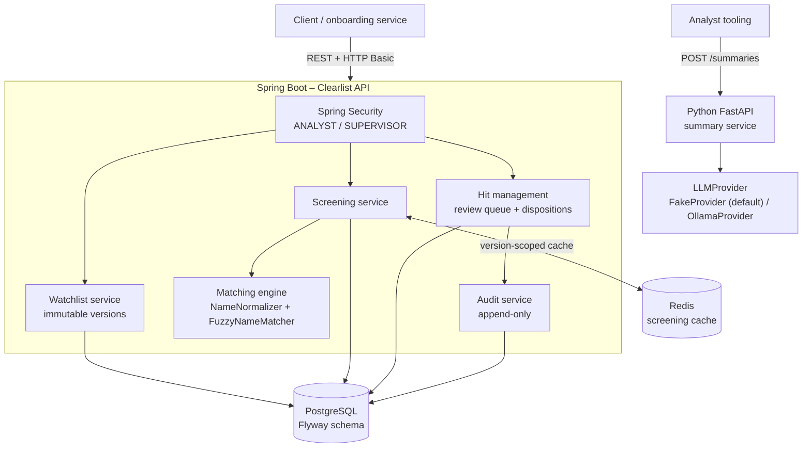

# Clearlist – Financial Crime Screening

Clearlist is a customer-screening backend for a retail bank. It screens newly onboarded customers against
sanctions and politically exposed persons (PEP) watchlists using fuzzy name matching, persists every screening
against the exact immutable watchlist version used, and gives analysts and supervisors an auditable review
workflow. A separate Python service writes fact-checked, analyst-facing summaries of hits.

> **Verification status.** Everything marked ✅ below was run in the development environment. Items marked
> ⚠️ were **not run** because Docker (PostgreSQL/Redis) was not available there. No results are claimed for them.

| Check | Status |
|---|---|
| `mvn test` from the repo root: 128 tests, H2 + in-memory cache, offline | ✅ passing |
| Matching evaluation (recall / false-positive rate) | ✅ recall 1.000, FPR 0.000 (see [§13](#13-evaluation-results)) |
| `pytest` from the repo root: 20 tests, offline | ✅ passing |
| Python service started with uvicorn and called | ✅ |
| Integration tests against real PostgreSQL + Redis (`-Pintegration`) | ⚠️ not run |
| Spring Boot app started against PostgreSQL | ⚠️ not run |
| Load test | ⚠️ not run |
| `EXPLAIN` of the review-queue query on PostgreSQL | ⚠️ not captured |

---

## 1. Project overview

| Task | Scope | State |
|---|---|---|
| 1 | Synthetic watchlist + labelled evaluation data, versioned watchlist upload (CSV/JSON), name normalisation, fuzzy matching, screening API, review queue, error handling, Flyway schema | Complete, tested |
| 2 | Redis screening cache (version-isolated), Spring Security (ANALYST / SUPERVISOR), hit disposition state machine, append-only audit trail, load-test script | Complete and tested offline; Redis/PostgreSQL paths not run |
| 3 | FastAPI hit-summary service with `LLMProvider` interface, deterministic `FakeProvider` (default), optional local `OllamaProvider`, DOB masking, output validation + fallback | Complete, tested (Ollama tested with a mocked HTTP call, not a live server) |

## 2. Architecture

A **modular monolith** (Spring Boot) with clear package boundaries, plus an independent Python service.

| Package (`com.azentio.clearlist`) | Responsibility |
|---|---|
| `controller` | REST endpoints only: validation and delegation, no business logic |
| `service` | Use cases: watchlist upload/versioning, screening, review queue, dispositions, transition policy |
| `service.upload` | CSV/JSON parsing and all-or-nothing row validation |
| `matcher` | `NameNormalizer`, `FuzzyNameMatcher`, `WatchlistMatcher`, immutable in-memory `WatchlistIndex` |
| `cache` | `ScreeningCache` interface with Redis, in-memory and no-op implementations |
| `audit` | Append-only disposition history (entity, insert/read-only repository, service) |
| `security` | HTTP Basic, in-memory users, roles, JSON 401/403 responses |
| `entity` / `repository` | JPA entities and Spring Data repositories (never returned from the API) |
| `dto` / `mapper` | API records and entity → DTO mapping |
| `exception` | Typed business exceptions + one `@RestControllerAdvice` producing a single error shape |
| `config` | Typed configuration properties, cache selection, `Clock` |

**Screening flow**

1. Normalise the name (case, diacritics, punctuation, honorifics, transliteration folding).
2. Resolve the current watchlist version once.
3. Look up the cache with key = (version, order-insensitive normalised name).
4. On a miss, score against the pre-normalised in-memory index for that version, then cache the result.
5. Persist a `screening` row and one `screening_hit` per entry ≥ threshold, even when the result came from the cache.

## 3. Architecture diagram



**Data model**: `watchlist_version` 1─* `watchlist_entry` 1─* `watchlist_entry_alias`;
`screening` *─1 `watchlist_version`; `screening` 1─* `screening_hit` *─1 `watchlist_entry`;
`screening_hit` 1─* `hit_audit_record`.

## 4. Technology stack

| Area | Choice |
|---|---|
| Backend | Java 17 target (built and tested on JDK 21), Spring Boot 3.3.5, Spring Web / Data JPA / Security / Validation / Data Redis |
| Database | PostgreSQL 16, Flyway migrations; H2 (PostgreSQL mode) for offline tests |
| Matching | Apache Commons Text (Jaro-Winkler); Apache Commons CSV for uploads |
| Tests | JUnit 5, Mockito, Spring MockMvc, AssertJ |
| Python | Python 3.12 (3.10+ required), FastAPI 0.115, Pydantic 2.9, pytest 8.3 |
| Infra | Docker Compose: PostgreSQL + Redis |

## 5. Prerequisites

- JDK 17+ (`JAVA_HOME` set) and Maven 3.9+ (`mvn`), or the wrapper `backend/mvnw` instead of Maven.
- Python 3.10+.
- Docker + Docker Compose for PostgreSQL/Redis (not needed for unit tests).

## 6. Environment setup

```bash
cp .env.example .env        # then replace every <placeholder> value
```

Spring Boot does not read `.env` itself; export it into the shell that starts the app or runs the tests:

```bash
# bash / Git Bash
set -a; source .env; set +a
```
```powershell
# PowerShell
Get-Content .env | Where-Object { $_ -match '^\s*[^#].*=' } | ForEach-Object {
  $k, $v = $_ -split '=', 2; Set-Item "env:$($k.Trim())" $v.Trim() }
```

Key settings (all have defaults except the passwords):

| Variable | Default | Meaning |
|---|---|---|
| `DB_URL`, `DB_USERNAME`, `DB_PASSWORD` | localhost / `clearlist` / **required** | PostgreSQL |
| `REDIS_HOST`, `REDIS_PORT`, `REDIS_PASSWORD` | localhost / 6379 / empty | Redis |
| `CACHE_TYPE` | `redis` | `redis` \| `memory` \| `none` |
| `CACHE_TTL` | `PT10M` | Cache entry lifetime (ISO-8601) |
| `MATCH_THRESHOLD` | `0.85` | Minimum name score for a hit |
| `MATCH_TOKEN_THRESHOLD` | `0.88` | Minimum Jaro-Winkler for two name tokens to count as equal |
| `MATCH_MAX_HITS` | `10` | Hits returned per response (all hits above threshold are persisted) |
| `CLEARLIST_ANALYST_PASSWORD`, `CLEARLIST_SUPERVISOR_PASSWORD` | **required** | Users `analyst` and `supervisor` |
| `SUMMARY_PROVIDER` | `fake` | Python summary provider |

## 7. Run PostgreSQL and Redis

```bash
docker compose up -d
docker compose ps           # both services should become "healthy"
```

## 8. Start the Spring Boot service

```bash
cd backend
./mvnw spring-boot:run      # http://localhost:8080 ; Flyway creates the schema on startup
```

> **Windows note:** `mvnw.cmd` failed in the development environment because the user-profile path
> contains a space (`C:\Users\<First Last>`). Use `./mvnw` from Git Bash, or a locally installed `mvn`.

## 9. Start the Python summary service

```bash
cd python-summary
python -m venv .venv
.venv/Scripts/activate      # Windows; on macOS/Linux: source .venv/bin/activate
pip install -r requirements.txt
uvicorn app.main:app --port 8000
```

**Switching to a real provider.** The provider is chosen with `SUMMARY_PROVIDER`:
- `fake`: default, deterministic, no network.
- `ollama`: a local [Ollama](https://ollama.com) server, no API key.

```bash
ollama pull llama3.1                      # once
SUMMARY_PROVIDER=ollama OLLAMA_MODEL=llama3.1 uvicorn app.main:app --port 8000
# optional: OLLAMA_BASE_URL (default http://localhost:11434), OLLAMA_TIMEOUT_SECONDS (default 30)
```

The real provider gets exactly the same masked prompt and the same output validation as the fake one. If
the server is unreachable, the response is the fact-only fallback summary with a warning. The Ollama
provider is tested with a mocked HTTP call; it was not run against a live Ollama server.

Adding another provider means one class implementing `LLMProvider.generate(prompt)` plus one entry in
`app/providers/__init__.py`.

## 10. API examples

Assumes the passwords are exported as in §6.

```bash
# Upload a watchlist version (SUPERVISOR only). CSV or JSON.
curl -u supervisor:$CLEARLIST_SUPERVISOR_PASSWORD \
     -F file=@data/watchlist.csv http://localhost:8080/api/watchlists/versions
# -> 201 {"versionId":1,"entryCount":2000,"loadedAt":"...","sourceFilename":"watchlist.csv"}

# Current version
curl -u analyst:$CLEARLIST_ANALYST_PASSWORD http://localhost:8080/api/watchlists/versions/current

# Screen a customer
curl -u analyst:$CLEARLIST_ANALYST_PASSWORD -H "Content-Type: application/json" \
     -d '{"customerRef":"CUST-001","fullName":"Aleksandr Petrov","dob":"1980-01-01","nationality":"RU"}' \
     http://localhost:8080/api/screenings
# -> 201 {"screeningId":"…","customerRef":"CUST-001","listVersion":1,"decision":"POTENTIAL_MATCH"|"CLEAR",
#         "totalHits":n,"topHits":[{"hitId":"…","entryId":"WL-…","matchedName":"…","score":0.93,
#         "matchedOn":"primary"|"alias","listType":"SANCTIONS","status":"OPEN"}],"cacheHit":false,"screenedAt":"…"}

# Review queue (newest first)
curl -u analyst:$CLEARLIST_ANALYST_PASSWORD "http://localhost:8080/api/hits?status=OPEN&page=0&size=20"

# Disposition (ANALYST: OPEN->ESCALATED|FALSE_POSITIVE ; SUPERVISOR: ESCALATED->CONFIRMED_MATCH|FALSE_POSITIVE)
curl -u analyst:$CLEARLIST_ANALYST_PASSWORD -H "Content-Type: application/json" \
     -d '{"toStatus":"ESCALATED","reason":"Requires supervisor review"}' \
     http://localhost:8080/api/hits/<hitId>/disposition

# Audit trail (chronological)
curl -u analyst:$CLEARLIST_ANALYST_PASSWORD http://localhost:8080/api/hits/<hitId>/audit

# Hit summary (Python service)
curl -H "Content-Type: application/json" http://localhost:8000/summaries -d '{
  "customerName":"Aleksandr Petrov","customerDob":"1980-04-17","customerNationality":"RU",
  "matchedName":"Aleksandr Ivanovich Petrov","matchedDob":"1980-01-01","matchedNationality":"RU",
  "matchedOn":"primary","score":0.93,"listType":"SANCTIONS","listVersion":1}'
```

**Errors** always use one shape:

```json
{"timestamp":"…","status":400,"error":"VALIDATION_FAILED","message":"Request validation failed",
 "path":"/api/screenings","details":[{"location":"fullName","message":"fullName is required"}]}
```

| Code | HTTP | When |
|---|---|---|
| `VALIDATION_FAILED` | 400 | Invalid body (e.g. missing `fullName`, blank `reason`) |
| `INVALID_PARAMETER` | 400 | Bad query/path parameter (`status=FOO`, `size=500`, malformed UUID) |
| `MALFORMED_REQUEST` | 400 | Unreadable JSON |
| `INVALID_NAME` | 400 | Name with nothing matchable (e.g. only "Mr.") |
| `MALFORMED_WATCHLIST` | 400 | Upload rows invalid; `details` lists every problem as `row N: field` |
| `EMPTY_WATCHLIST` | 400 | Upload has no entries |
| `UNSUPPORTED_FILE_TYPE` | 400 | Not `.csv` / `.json` |
| `UNAUTHORIZED` / `FORBIDDEN` | 401 / 403 | Missing credentials / role not allowed |
| `TRANSITION_NOT_PERMITTED` | 403 | Disposition not allowed for the caller's role |
| `NOT_FOUND` | 404 | Unknown hit, or no watchlist loaded (`GET …/current`) |
| `WATCHLIST_NOT_LOADED` | 409 | Screening before any watchlist upload |
| `INVALID_TRANSITION` / `CONCURRENT_MODIFICATION` | 409 | Status does not allow the transition / hit changed concurrently |

## 11. Unit tests (offline)

From the repository root:

```bash
mvn test        # 128 tests: H2 (PostgreSQL mode) + in-memory cache, no Docker (or: cd backend && ./mvnw test)
pip install -r python-summary/requirements.txt
pytest          # 20 tests
```

Regenerate the synthetic data (deterministic, seed 42):

```bash
python scripts/generate_watchlist.py      # -> data/watchlist.csv, data/watchlist.json, data/evaluation.csv
```

| Test class | Covers |
|---|---|
| `NameNormalizerTest` | Case, diacritics, punctuation, honorifics (Mr/Mrs/Dr/Shri), token order, Arabic article, transliteration folding |
| `FuzzyNameMatcherTest` | 17 named true-match cases, including the brief's `Aleksandr Petrov`/`Alexander Petroff`, `Dr. Chen Wei`/`Wei Chen` and `J. R. Fernandes`/`João Ricardo Fernandes`; 10 named false-positive cases; symmetry/range |
| `WatchlistMatcherTest` | Alias matching, best name per entry, configurable threshold, shared-surname rejection |
| `WatchlistUploadParsingTest` | CSV/JSON parsing, every row error reported together, bad headers/types |
| `WatchlistAndScreeningApiTest` | Versioning, screening + hit persistence, **new version used by later screenings**, review queue ordering, error responses |
| `MatchingEvaluationTest` | Recall ≥ 0.90 and FPR ≤ 0.10 on the labelled dataset via the real upload + screening pipeline |
| `DispositionAndSecurityApiTest` | The **six assessment scenarios**, audit trail contents/order, 401/404/400 |
| `HitTransitionPolicyTest` | Full role × status matrix (200/403/409) |
| `ScreeningServiceCacheTest`, `InMemoryScreeningCacheTest`, `RedisScreeningCacheTest` | Cache key changes with the list version; cache hits still persist a screening; a name screened before and after an upload is re-evaluated; TTL; fail-open on Redis errors; no plain names in keys |
| `AuditAppendOnlyTest` | Audit records cannot be deleted or modified through the application |

## 12. Integration tests (PostgreSQL + Redis) ⚠️ not run

Tagged `@Tag("integration")` and excluded from the default build. With Docker running and `.env` exported:

```bash
mvn test -Pintegration          # from the repository root
```

`PostgresRedisIntegrationTest` checks the Redis cache (hit on repeat, TTL set, miss after a new version) and
prints the PostgreSQL plan for the review-queue query.

## 13. Evaluation results

Dataset: `data/evaluation.csv` (65 rows, generated from `data/watchlist.csv`, 2,000 entries).

| | Rows | Result |
|---|---|---|
| True-match variants | 40 | **40 found, recall 1.000** (target ≥ 0.90) |
| NONE / negative rows | 25 | **0 false positives, FPR 0.000** (target ≤ 0.10) |

Variant mix. True matches: transliteration 8, swapped order 5, honorific 5, missing middle name 5,
diacritics 5, case/punctuation 4, initials 4, combined 4. Negatives: shared surname 6, first name and surname
taken from different listed people 6, shared first name 5, single token 4, unlisted common name 4.

**Read these numbers with care.** The dataset is synthetic and was written by the same author as the matcher.
The first evaluation run scored recall 1.000 but **FPR 0.360**. The matcher was then changed:
- a single-token name can no longer match a multi-token name;
- the token threshold was raised from 0.80 to 0.88, chosen from measured Jaro-Winkler values;
- transliteration folding was added;
- tokens of very different length (`ivan` vs the patronymic `ivanovich`) no longer match.

The dataset was not changed to suit the matcher, but this is still tuning on the evaluation set, not a held-out
test. Expect lower figures on real list data.

## 14. Load-test results ⚠️ not run

`scripts/load_test.py` (standard library only) sends 1,000 screening requests. About 50% reuse a pool of
20 names; the rest are unique (495 distinct names in total, so the maximum possible cache-hit ratio is ≈ 0.50).
It reports p50/p95 latency and the cache-hit ratio from each response's `cacheHit` flag.

```bash
# start the API with CACHE_TYPE=redis, upload data/watchlist.csv, then:
python scripts/load_test.py --label cache-enabled
# restart the API with CACHE_TYPE=none:
python scripts/load_test.py --label cache-disabled
```

No results are recorded because PostgreSQL/Redis were not available. Fill in after running:

| Run | p50 (ms) | p95 (ms) | Cache-hit ratio |
|---|---|---|---|
| cache-enabled | – | – | – |
| cache-disabled | – | – | – |

## 15. Review-queue index ⚠️ EXPLAIN not captured

The queue query is `WHERE status = ? ORDER BY created_at DESC LIMIT ? OFFSET ?`, served by:

```sql
CREATE INDEX idx_screening_hit_status_created_at ON screening_hit (status, created_at DESC);
```

The index contains both the equality column and the sort column in the required order, so PostgreSQL can read
the first page straight from it without sorting. The integration test runs and prints `EXPLAIN` for this
query. It has not been run, so no plan output is shown here.

## 16. Design decisions and known limitations

**Matching**
- Matching is **name-only**. DOB and nationality are stored and shown to reviewers, but they do not change the
  score, so a wrong DOB on file cannot hide a true match. Because of this they are also not part of the
  cache key (`ScreeningCacheKey` documents that they must be added if they ever affect scoring).
- How a score is computed:
  - names are compared token by token, regardless of word order;
  - each pair of tokens is compared with Jaro-Winkler after transliteration folding;
  - token pairs below 0.88 contribute nothing;
  - score = sum of matched token scores ÷ (tokens in the shorter name + 0.15 × extra tokens in the longer).

  A missing middle name costs a little; a shared surname alone cannot reach the threshold.
- **Limitation:** string similarity cannot tell some distinct names apart: `khalil/khalid` scores 0.93 and
  `samir/amir` scores 0.93. Such names are only flagged when every other name part also matches.
- **Limitation:** nicknames (Sasha ↔ Aleksandr) only match when the list contains them as aliases.
- **Limitation:** non-Latin scripts (Cyrillic, Arabic) are not transliterated to Latin.
- **Limitation:** every screening scores every entry of the current version (about 6,000 names for 2,000
  entries). That is fine at this size; millions of entries would need blocking or a search index (e.g. a
  phonetic key or trigram index).

**Watchlist versions**
- Versions are immutable, and the current version is simply the newest one. An upload is all-or-nothing:
  any invalid row rejects the whole file.

**Cache**
- **Limitation:** `InMemoryScreeningCache` has no size limit and is intended for tests and offline runs only.
- **Limitation:** cached results don't include the matcher settings. If the matching thresholds change, results
  cached before the change are served until the TTL expires.

**Security**
- **Limitation:** users are in memory with HTTP Basic auth. A real deployment would use the bank's identity
  provider (OIDC).

**Audit**
- The audit trail is append-only at the application layer: the repository only inserts and reads, the entity is
  `@Immutable`, and its `@PreUpdate`/`@PreRemove` callbacks reject changes.
- **Limitation:** the database itself does not yet enforce this. A real deployment should also
  `REVOKE UPDATE, DELETE` on that table from the application's database role.

**Python summary service**
- **Stricter than the brief:** the brief asks to reject dates that do not appear in the input. Here
  *every* full date is rejected, because the prompt only ever contains birth years (both parties' DOBs are
  masked to `YYYY-**-**`), so a provider cannot legitimately produce one. Only the two parties' birth years
  are allowed.
- **Limitation:** output validation is regex-based (years, full dates, list types, list programmes, match
  conclusions), so unusual wording may slip through.
- **Limitation:** the Ollama provider has only been tested with a mocked HTTP call.

**Integration and build**
- **Limitation:** the Java API does not call the summary service yet.
- **Limitation:** `mvnw.cmd` fails when the user path contains a space (see §8); plain `mvn` from the root works.

## 17. Next steps

1. Run the integration tests, the load test and `EXPLAIN` on PostgreSQL + Redis, and record the real results above.
2. Evaluate on a larger, independently labelled dataset (ideally public sanctions-list variants) and tune the
   thresholds per list type.
3. Optional DOB/nationality corroboration that only raises or annotates scores, never suppresses a hit.
4. Candidate blocking (phonetic or n-gram keys) so matching does not scan every entry as lists grow.
5. Run the Ollama provider against a live model, and have the Java hit-detail endpoint call the summary service
   with a timeout and graceful fallback.
6. OIDC authentication, a database-level REVOKE on the audit table, and metrics (cache-hit ratio, match latency).
